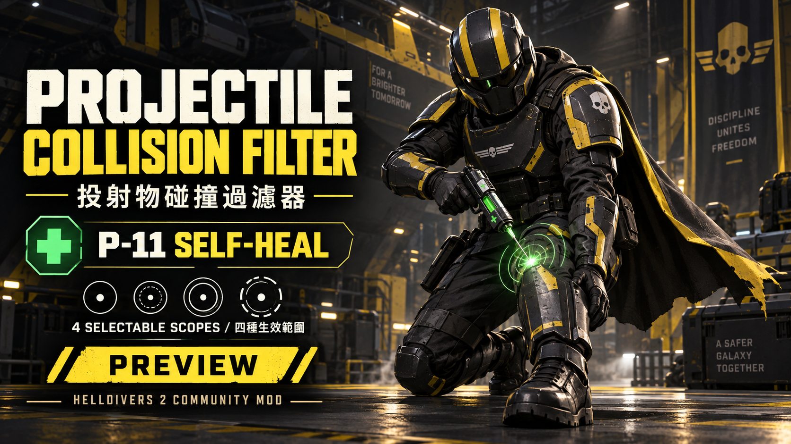

# Projectile Self Hit｜子彈能擊中自己・HellForge v1

[English](README.en.md) · [下載 v1.0.0](https://github.com/cainiao524/HD2-Projectile-Collision-Filter/releases/tag/v1.0.0) · [原理](docs/HOW-IT-WORKS.md) · [更新紀錄](CHANGELOG.md) · [舊版留檔](archive/README.md)

讓潛兵自己射出的子彈能擊中自己。最初是為了 **P-11 治療手槍自我治療**，現在可以四選一擴大到其他潛兵武器。效果完全交給遊戲原生的碰撞與命中邏輯：本模組不寫血量、不模擬治療，只讓指定射彈在生成時不帶「排除擁有者」旗標。

**這是 HellForge 版。**舊的 Arsenal／BSL 版（v0.3.0-preview.8 及之前）是射彈生成後再逐發清旗標，霰彈槍和大量射彈時會掉幀；v1 改在旗標產生的源頭判斷，每發射彈只多一次查表，開銷與範圍、彈丸數都無關。

## 兩個下載

| 下載檔 | 用途 |
|---|---|
| `Projectile-Self-Hit-HellForge-v1.0.0-build25480438.zip` | **本體（必裝）**：HellForge code mod `local.p11-self-hit-fast`。原始碼包，HellForge 會自動建置。 |
| `Projectile-Self-Hit-Options-MOM-v1.0.0.zip` | **遊戲內選單（選裝）**：在 ESC > MODS（Mod Options Menu）選生效範圍，按 APPLY 立即生效。 |

SHA-256 見 [Release 正文](https://github.com/cainiao524/HD2-Projectile-Collision-Filter/releases/tag/v1.0.0)。GitHub 自動產生的 Source code 壓縮檔是整個倉庫，不是安裝包。

## 生效範圍（四選一）

| 選項 | 範圍 |
|---|---|
| **P-11 Only / 僅治療手槍** | 只有 P-11 治療針。推薦，預設。 |
| **All Sidearms / 手槍全部** | P-11 與副武器射彈，排除霰彈／多彈丸。 |
| **All Weapons (No Shotguns) / 全部武器不包括霰彈槍** | 主武器、支援武器、副武器射彈，排除霰彈／多彈丸。 |
| **All Weapons (Including Shotguns) / 全部武器包括霰彈槍** | 全部，包含霰彈。彈丸可能在槍口就打到自己；本模組本身不會因此增加開銷。 |

傷害型武器擊中自己時，同樣是原生傷害，會自傷。

## 安裝

1. 關閉遊戲。在 HellForge 的 Mods 頁把 `Projectile-Self-Hit-HellForge-v1.0.0-build25480438.zip` 拖進 mods 資料夾（或解壓後放入），啟用 **Projectile Self Hit / 子彈能擊中自己**。
2. **一次只開一個自命中模組**：停用 `cainiao524.p11-self-hit`（0.5.x）、BSL 四選一版、Arsenal 的 Projectile Collision Filter 等舊版。
3. 想在遊戲內切換範圍：另外安裝 [Bingus Shared Loader](https://github.com/CowboyBingus/BingusSharedLoader) 與 [Mod Options Menu](https://github.com/CowboyBingus/ModOptionsMenu)，再加入 `Projectile-Self-Hit-Options-MOM-v1.0.0.zip` 並啟用。進遊戲後在 **ESC > MODS > PROJECTILE SELF HIT** 選 **Effect Scope / 生效範圍**，按 APPLY（Tab）。
4. 不裝選單也可以：改 mod 資料夾裡的 `self-hit.ini`（第一次執行時自動產生），`scope=1` 到 `4`，存檔後約 2 秒內生效。有選單時這個檔案會跟著選單更新。

適用 **Steam build 25480438**（HellForge 支援的版本）。遊戲版本不符、或補丁位置的位元組不是預期的原版程式碼時，模組不做任何修改，並在 `mod-local.p11-self-hit-fast.log` 寫出原因。

## 原理（簡述）

遊戲的射彈生成函式（`game.dll+0x13a9830`）會為每發射彈組出一個旗標字；其中 `0x20` 是「排除擁有者」，命中判定（`+0x13ac6a1`）看到它就跳過開槍者本人。v1 把決定這個旗標的 20 位元組（`+0x13a9bbd`）換成一個絕對跳轉，跳到模組自己的小段程式：以射彈 type 查一張 1024 位元組的表，在表內就不給 `0x20`，其餘照原版邏輯，然後跳回原處。

- 沒有 hook、沒有每幀輪詢射彈池、不寫堆記憶體；切換範圍只重建那張表。
- 表由各武器紀錄裡的射彈 type 建出（主／支援／副武器目錄來自 HellForge SDK），霰彈以名稱與每發彈丸數判斷。
- 選單包是一個極小的 BSL Lua addon：只向 Mod Options Menu 註冊一個選項，並把選到的值交給已載入的 DLL（`p11_self_hit_set_scope`），不碰射彈也不讀寫遊戲記憶體。

詳細的位址、組語與驗證方式見 [docs/HOW-IT-WORKS.md](docs/HOW-IT-WORKS.md)。

## 已知限制

- 判斷依據是**射彈 type**：如果哨戒砲、載具或敵人用了和所選武器相同的射彈 type，它們的射彈也會不排除自己的發射者（尚未逐一確認）。
- 多人：每台電腦只改自己的模擬。沒裝的隊友不受影響；隊友射出、在你這台模擬的同 type 射彈也不會排除擁有者，實際表現尚未完整驗證。
- 只支援射彈（projectile）路徑；光束、噴射、電弧類武器不在範圍內。
- 作者已在遊戲內實測可用；尚未做逐武器、主客機的完整驗證矩陣。

## 搭配

推薦 P-11 搭配 [Raise Weapon: Aim at Yourself / 舉槍瞄準自己](https://ayakamods.com/mods/raise-weapon-aims-at-yourself.3946/)（另行下載）。也可以第一人稱朝自己腳下射擊。

## 從原始碼建置

- 本體：把 `hellforge/p11-self-hit-fast` 複製到 HellForge 的 `mods` 資料夾，Mods 頁 **Build now**，或 `HellForge.Cli build-mod --mod <該資料夾>`（遊戲需關閉）。
- 選單包：`python -I tools/build_options_pack.py` 從 `hellforge/options-addon/p11_self_hit_options.lua` 重建 `hellforge/p11-self-hit-options`。
- Release ZIP：`python -I tools/package_release.py` → `dist/`（可重現，附 SHA256SUMS）。
- 選單整合測試（不需遊戲）：`luajit tests/test_options_addon.lua <p11_self_hit_fast.dll> hellforge/options-addon/p11_self_hit_options.lua`。

## 致謝與授權

[HellForge](https://github.com/SkyeShade/HellForge)（SkyeShade）提供 mod SDK；[Mod Options Menu](https://github.com/CowboyBingus/ModOptionsMenu) 與 [Bingus Shared Loader](https://github.com/CowboyBingus/BingusSharedLoader)（CowboyBingus）是外部依賴，本倉庫不包含也不再散布它們。授權說明見 [LICENSE-NOTICE.md](LICENSE-NOTICE.md)。
